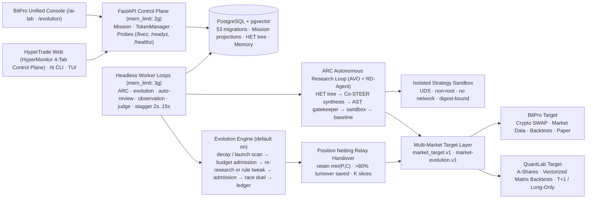
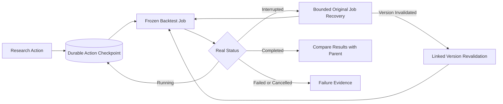

# HyperTrade & ARC (Autonomous Research Core)

<p align="center">
  <strong>Self-Hosted, Governed Multi-Market Strategy-Research Agent Runtime · Autonomous Research & Evolution Loop</strong>
</p>

<p align="center">
  <a href="https://github.com/Shadowell/HyperTrade/releases"></a>
  <a href="LICENSE"></a>
  <a href="https://github.com/Shadowell/HyperTrade/actions/workflows/ci.yml"></a>
  <a href="https://github.com/Shadowell/HyperTrade/discussions"></a>
  <a href="#"></a>
  <a href="#"></a>
  <a href="#"></a>
  <a href="#"></a>
  <a href="#"></a>
  <a href="#"></a>
  <a href="docs/architecture/63-evolution-effectiveness-alerts-and-benchmark.md"></a>
  <a href="docs/architecture/66-quantlab-adapter-a-share-microstructure-and-relay-handover.md"></a>
</p>

<p align="center">
  🌐 <strong>English</strong> ·
  <a href="README.zh-CN.md">🇨🇳 中文说明</a> ·
  <a href="docs/architecture/00-overview.md">Architecture Overview</a> ·
  <a href="docs/architecture/33-system-architecture.md">System Architecture</a> ·
  <a href="docs/architecture/62-pluggable-market-targets.md">Pluggable Market Targets</a> ·
  <a href="docs/architecture/65-rd-agent-evolution-and-finmem-layered-memory.md">RD-Agent Evolution</a> ·
  <a href="docs/architecture/66-quantlab-adapter-a-share-microstructure-and-relay-handover.md">QuantLab & A-Share Rules</a> ·
  <a href="docs/architecture/67-production-observability-probes-and-token-rotation.md">Production Probes & Tokens</a> ·
  <a href="docs/architecture/68-external-ground-truth-stream-and-headline-arena.md">External Ground Truth</a> ·
  <a href="docs/spec.md">Product Spec</a>
</p>

---

## 🌟 Overview

**HyperTrade** is a self-hosted, governed Agent runtime for quantitative strategy research and autonomous evolution. It transforms natural-language research goals into verifiable **Missions** constrained by permissions, budgets, evidence, and human review. The ARC autonomous research loop (powered by Microsoft RD-Agent Hypothesis Evolution Trees and Co-STEER structured synthesis) proposes candidate strategies, tests them via isolated sandboxes and same-window baselines, and deploys them to target paper trading environments (**BitPro for Crypto SWAP** and **QuantLab for A-Shares / multi-asset equities**). In production, an **always-on evolution engine** continuously scans for benchmark-relative performance decay, triggers targeted re-research, and performs **position netting smooth relay handovers** during strategy promotion, saving >80% in turnover friction.

Four core principles:

- **Governed, never self-authorizing.** The model only produces schema-bounded plans and code; permissions, approvals, budgets, and risk gates are validated independently before and after execution. Mainnet live trading is hard-blocked (`live_allowed=false`); external writes target only authorized paper trading instances.
- **Pluggable markets with native microstructure enforcement.** The core evolution engine is completely decoupled from underlying trading platforms via `market_target.v1` profiles and `market-evolution.v1` MCP contracts. For Chinese A-shares, hard institutional rules are strictly enforced across Prompt and ASTGatekeeper levels: T+1 settlement state machine, spot long-only enforcement (no naked shorting), price limit band liquidity cutoffs, 100-share lot size constraints, and institutional friction models (0.05% stamp duty, transfer fees, commissions, and slippage).
- **Hypothesis-driven scientific evolution with minimal friction.** Integrates RD-Agent's Hypothesis Evolution Tree (HET) for genealogical tracking and explicit hypothesis pruning. During champion-challenger promotions, two-leg position netting ($\Delta = C - P$) preserves common holdings $\min(P_i, C_i)$, cutting turnover costs by over 80%.
- **External selection pressure with third-party Ground Truth.** Integrates external forward-only prediction arenas (Headline Arena) for objective real-price settlement and Brier scoring, supplying ARC simulation incubation and causal attribution with unpolluted external truth signals.
- **Zero-trust credential governance and cloud-native observability.** Production container health probes (`/livez`, `/readyz`, `/healthz`) provide granular diagnostics for Kubernetes and load balancers. `TokenRotationService` provides SHA-256 hashed credentials, zero plaintext persistence, granular scopes, and zero-downtime 24-hour grace period hot rotation.

It is not an automated money maker, promises no profitability, and does not provide investment advice.

---

## 🏗️ System Topology



External trading platforms remain the source of truth for their own domains. HyperTrade maintains only bounded references, digests, hashes, metrics, and audit projections, never replicating private platform logic or directly accessing private databases.

---

## 🔁 Core Capabilities

### 1. Governed Agent Runtime & Zero-Trust Token Rotation
The source of truth for research tasks is the **Mission** (Plan / Step / Event / budgets / approvals / completion proof); interaction is driven by the server-owned **Thread / Turn / Item** protocol with resumable cursor SSE. External writes require one-shot parameter-bound approvals and write-ahead DispatchIntent records. The platform integrates **`TokenRotationService`**: credentials store only SHA-256 hashes, support granular scopes (`arc:read`, `arc:start`, etc.), seamless 24-hour grace periods during hot rotation, and proactive 7-day expiration audits.

Design docs: [30 Roadmap](docs/architecture/30-professional-agent-runtime-v2-roadmap.md) · [31 Technical Design](docs/architecture/31-professional-agent-runtime-v2-technical-design.md) · [67 Probes & Token Rotation](docs/architecture/67-production-observability-probes-and-token-rotation.md)

### 2. ARC Research Core & RD-Agent Hypothesis Evolution (HET + Co-STEER)
Extracts key methodologies from Microsoft RD-Agent:
- **Hypothesis Evolution Tree (HET)**: Maintains complete hypothesis lineages from root to mutant branches, explicitly pruning underperforming or overfitted hypotheses.
- **Co-STEER Structured Code Synthesis**: Guides LLMs to generate modular features, signals, and sizing logic.
- **ASTGatekeeper Syntax & Anti-Lookahead Gate**: Statically scans AST nodes at compile time to block lookahead bias, future data leakage, and unauthorized system calls.
- **Isolated Sandbox & Same-Window Baselines**: Bounded UDS sandboxing with byte-identical time window comparisons.

Design docs: [65 RD-Agent Evolution & Layered Memory](docs/architecture/65-rd-agent-evolution-and-finmem-layered-memory.md) · [37 ARC Architecture](docs/architecture/37-arc-autonomous-research-core-architecture.md) · [61 Research Loop Rationalization](docs/architecture/61-research-loop-architecture-rationalization.md)

### 3. Multi-Market Targets & A-Share Microstructure Rules
The evolution core decouples from execution platforms via `market_target.v1` and `market-evolution.v1`:
- **BitPro Target**: 24/7 perpetual cryptocurrency swaps, dual-direction long/short.
- **QuantLab Target**: A-share equities; `QuantLabStrategyTranspiler` translates standard strategies into native vectorized `MatrixStrategy` modules with isolated `_BASE_EVO_SCAFFOLD`.
- **Institutional Hard Rules**: Prompt contexts and ASTGatekeeper strictly enforce T+1 settlement state machines, spot long-only enforcement (blocking `-1` short signals), price limit bands, 100-share integer lot sizes, and exact institutional friction models (0.05% stamp duty, transfer fees, commissions).

Design docs: [62 Pluggable Market Targets](docs/architecture/62-pluggable-market-targets.md) · [66 QuantLab & A-Share Microstructure](docs/architecture/66-quantlab-adapter-a-share-microstructure-and-relay-handover.md)

### 4. Evolution Engine & Position Netting Smooth Relay Handover
Scans active incubating paper strategies hourly:
- **Benchmark-Relative Decay Detection**: Strategy performance change over 14 days minus benchmark buy-and-hold change prevents broader market drops from falsely flagging strategy decay.
- **Position Netting Relay Service**: During strategy turnover, intersecting holdings $\min(P_i, C_i)$ are preserved in place. Only net differences $\Delta = C - P$ are sliced and executed over $K$ periods with 100-share constraints, slashing turnover friction by >80%.
- **Effectiveness Ledger & Feishu Alerts**: Full ledger accounting with automatic Feishu webhook card alerts for stalled data gaps and error streaks.
- **Variant Supply for Every Parent (opt-in)**: once a paper parent has run 7 complete days it can receive variants before full decay evidence exists; exploration missions can use a deterministic one-step parameter-neighbour researcher, and a candidate that fails the strict final gate may still race if it is not clearly worse than its parent on the same window. Succession still requires winning the forward race.
- **Production Variant Pipeline & `production_3slot` Preset**: `ARC_AVO_RESEARCH_ENABLED=true` keeps `avo_research_loop` enabled by default without requiring `MISSION_RUNTIME_WORKER_ENABLED`, while `ARC_EVOLUTION_BOOTSTRAP_PRESET` and `POST /api/v1/arc/evolution/preset` support applying `EVOLUTION_PRESETS["production_3slot"]`. `evaluate_auto_review` validates `is_source_variant` candidates against their bound `research_capital` up to `10000` (unblocking 1000U+ BitPro variants) and scales `policy_passed` via `effective_validation_criteria`.

Design docs: [63 Evolution Hardening](docs/architecture/63-evolution-effectiveness-alerts-and-benchmark.md) · [66 Smooth Relay Handover](docs/architecture/66-quantlab-adapter-a-share-microstructure-and-relay-handover.md)

### 5. Production Probe Matrix, Headless Engine Mode & BitPro Console Consolidation
- **Headless Research Engine (`HYPERTRADE_HEADLESS_MODE`)**: In production (`docker-compose.yml` defaults `HYPERTRADE_HEADLESS_MODE` to `true`, with `api` capped at `mem_limit: 2g`, `worker` at `mem_limit: 3g`, and `MALLOC_ARENA_MAX=2` across shared `hypertrade-api:latest` runtime containers), BitPro (`/ai-lab` and `/evolution`) serves as the single operator console while the HyperTrade Web UI displays a prominent redirect banner. Heavy local data/scraping packages (`pandas`, `numpy`, `pyarrow`, `backtrader`, `yfinance`) are lazy-loaded only on demand (cutting cold-start RSS by ~259 MB across `api` + `worker`), worker heartbeats periodically invoke Linux `malloc_trim(0)` off the event loop, and RAG, 3-tier cognitive memory, and cross-mission `avo.development` recall use narrow SQL column/JSON projections instead of full-row ORM deserialization. The worker disables redundant standalone `market_ingestion`, `market_rest_supplement`, `paper_trading`, and `autonomous_market_pulse` loops (also controllable via `MARKET_INGESTION_ENABLED`) and staggers non-critical initial scans (`arc_evolution` 2s, `arc_observation` 5s, `cognitive_memory_replay` 8s, `arc_meta_tuning` 12s, `rag_scanner` 15s) to eliminate `t=0` restart spikes. `bitpro/mcp.py` accepts multiple PnL/drawdown field aliases from `strategy_search(status=running)` and suppresses false-positive `monitor_data_gap` warnings when `paper_dashboard` metrics are healthy. Contract: [Headless BitPro Fusion](docs/contracts/headless-bitpro-fusion.md).
- **Probe Matrix**: `/livez` (liveness), `/readyz` (readiness with `SELECT 1` DB probe), `/healthz` (comprehensive diagnostics with DB latency, adapter heartbeats, worker liveness, paper session counts, and token status), `/version` (the running commit SHA, which the deploy workflow checks after every deploy), fully aligned with Kubernetes standards.
- **HyperMonitor Control-Plane Workbench (`/harness`)**: React 19 + TypeScript 5.9 + Tailwind CSS 3-tier console (`ConsoleShell`) with Obsidian Dark (`#070708`/`#141416`, violet-magenta gradient) and Light themes, converged from 9 legacy views into 4 lazy-loaded routes (`/harness` Co-Pilot & Flight Recorder, `/harness/missions` ARC 3-Slot Evolution & Missions, `/harness/knowledge` 3-Tier Cognitive Memory & Governance, `/harness/system` Worker/Stall Forensics, Unified Alerts, Runtime Errors & Evals). Initial `/harness` mount strictly fetches only `GET /api/harness/overview` (headless-aware with `missions_summary`) and `GET /api/healthz`.

Design docs: [09 Frontend Harness](docs/architecture/09-frontend-harness.md) · [67 Production Probes & Token Rotation](docs/architecture/67-production-observability-probes-and-token-rotation.md)

---

## 🛡️ Bounded Recovery & Quality Gates

Source parameter proposals must bind verifiable citations, explicit counter-evidence, and net profit increase / drawdown reduction targets; merely decreasing trade count is not an improvement. Known execution failures settle separately as failed research and must not mutate further as trading performance. Source backtest comparisons require identical execution environments, costs, frozen market data, and economic inputs; formal Paper audits must match the final passing receipt and source code. Operator pauses cannot be overridden by stale receipts. Deployment health check disconnects perform bounded retries only for existing action receipts, halting after 5 failures or a 24-hour limit; audit recovery scripts can re-verify original bindings to resume deployment disconnect waits without replenishing budget or resetting Paper history.

Same-version interruptions resume original jobs; when execution environments or backend packages have changed, original frozen verifications are strictly preserved, creating linked new-version revalidations with identical economic inputs. Existing jobs and snapshots are never overwritten, and the recovery chain remains bounded by a 2-retry limit; known waiting states display as validating rather than prompting manual operator handling.

Research backtests durably save action checkpoints before and after external side effects: requests, attempts, source code, jobs, and frozen inputs are bound together; after disconnects, the original job is read, with interrupted jobs recovering up to 2 times, and failed/cancelled jobs never retried. After 5 consecutive read failures or a 24-hour wait, explicit reconciliation is demanded, and operator stops cannot be overwritten by recoverers. Deployment sequencing prioritizes BitPro durable idempotent interfaces.



Deployments discover the BitPro host gateway from the active Docker network and verify DNS and authentication health requests for API/workers. Unknown development side effects converge only via exact external reconciliation receipts, never blindly retrying or falsely declaring success.

---

## 💻 Quick Start

### Backend & Database

```bash
uv sync
docker compose up -d postgres
uv run alembic upgrade head
uv run uvicorn hypertrade.main:app --app-dir backend/src --reload --host 0.0.0.0 --port 3334
```

Standalone worker process (production Compose runs with `HYPERTRADE_HEADLESS_MODE=true`, keeping ARC research, evolution, observation, reconciliation, race judge, monitoring, heartbeat, RAG, and Mission loops):

```bash
uv run python -m hypertrade.worker
```

### Frontend

```bash
cd frontend && pnpm install && pnpm dev
```

### Health Probes

```bash
curl http://localhost:3334/livez
curl http://localhost:3334/readyz
curl http://localhost:3334/healthz
```

### Query Targets and Trigger Research

Query registered market targets:
```bash
curl http://localhost:3334/api/portfolio/targets
```

Trigger an autonomous cryptocurrency trend strategy research mission:
```bash
curl -X POST http://localhost:3334/api/v1/arc/missions \
  -H "Content-Type: application/json" \
  -H "Idempotency-Key: demo-crypto-1" \
  -d '{
    "objective": "Research a trend strategy adapted to BTC high volatility, incubate to paper after validation",
    "symbol": "BTC-USDT-SWAP",
    "timeframe": "1H",
    "max_candidates": 5
  }'
```

Inspect HET tree and relay handover plans:
```bash
curl http://localhost:3334/api/research/hypothesis-tree
curl http://localhost:3334/api/portfolio/relay/handovers
```

---

## 🧪 Verification & Quality Gates

```bash
./scripts/check.sh
```

Single command executes all quality gates: Frontend lint, Vitest (72 tests), and production build + Backend Ruff linting/formatting, strict Mypy type-checking, and full Pytest suite (currently 3089 tests passing).

---

## 🛠️ Tech Stack

| Layer | Technologies |
|-------|-------------|
| **Control Plane** | FastAPI 0.122+ / Uvicorn, scoped security tokens, `/livez`, `/readyz`, `/healthz` container probes, cursor SSE |
| **Credential Security**| `TokenRotationService` (SHA-256 single-way hashing, zero plaintext storage, 24h grace period hot rotation, 7-day expiration audit) |
| **Domain & Runtime** | Python 3.12+, Pydantic v2 strict models, modular monolith + ports-and-adapters |
| **Storage** | SQLAlchemy 2.0 + Alembic (53 migrations), PostgreSQL 14+ with `pgvector` |
| **Workers** | asyncio + PostgreSQL SQL lease locking (supervised concurrent background loops; headless mode omits local market/paper/pulse loops, `avo_research` enabled by default) |
| **Research Core** | ARC + RD-Agent Hypothesis Evolution Tree (HET) + Co-STEER synthesizer + `ASTGatekeeper` |
| **Target Adapters** | `market_target.v1` and `market-evolution.v1` MCP contracts; BitPro (Crypto) + QuantLab (A-Shares) |
| **A-Share Rules** | `AShareMarketRules` / `AShareRuleValidator` (T+1 state machine, spot long-only, 100-share lot size, exact fees) |
| **Relay Handover** | `PositionNettingRelayService` (retain $\min(P,C)$, net orders $\Delta = C-P$, >80% turnover saved) |
| **Sandbox** | UDS isolated processes, non-root, no network, read-only root, resource caps, digest-bound |
| **Frontend & UI** | React 19 + TypeScript 5.9 + Vite 8 + Tailwind CSS (HyperMonitor 4-Tab Control Plane); Tauri desktop; Textual TUI; `ht` CLI |
| **Deployment** | Docker Compose + Nginx + GitHub Actions (auto-deploy on push to `main`) |

---

## 📚 Documentation Map

| Entrypoint | Contents |
|------------|----------|
| [Architecture Overview](docs/architecture/00-overview.md) | Reading guide and **mandatory architecture synchronization rule** |
| [33 System Architecture](docs/architecture/33-system-architecture.md) | Canonical system architecture snapshot: multi-market targets, runtime layers, safety & probes |
| [66 QuantLab & A-Share Rules](docs/architecture/66-quantlab-adapter-a-share-microstructure-and-relay-handover.md) | QuantLab adapter, strategy transpiler, A-share hard rules, position netting relay |
| [09 Frontend Harness](docs/architecture/09-frontend-harness.md) | HyperMonitor 4-tab control-plane workbench, dual-theme shell, strict on-demand loading |
| [67 Production Probes & Tokens](docs/architecture/67-production-observability-probes-and-token-rotation.md) | `/livez`, `/readyz`, `/healthz` probes, `TokenRotationService`, worker stall forensics |
| [65 RD-Agent Evolution & Memory](docs/architecture/65-rd-agent-evolution-and-finmem-layered-memory.md) | Hypothesis Evolution Tree (HET), Co-STEER synthesis, FinMem 3-tier cognitive memory |
| [64 Autonomous Trading Agent](docs/architecture/64-autonomous-trading-agent-system-architecture.md) | Perception bus, tri-speed decision cycles, and bounded autonomous execution |
| [62 Pluggable Market Targets](docs/architecture/62-pluggable-market-targets.md) | `market_target.v1` / `market-evolution.v1` contracts and integration |
| [63 Evolution Hardening](docs/architecture/63-evolution-effectiveness-alerts-and-benchmark.md) | Effectiveness ledgers, data-gap alerts, benchmark-relative decay |
| [Product Spec](docs/spec.md) | Product scope, user journeys, acceptance criteria, non-goals |
| [Progress Log](docs/progress.md) | Current verified state and production evidence |
| [Delivery Contracts](docs/contracts/) | Sprint-by-sprint scope and technical contracts |
| [Runbooks](docs/runbooks/) | Deployment, monitoring, and incident response |
| [Developer Guide](docs/developer-guide.md) | Local development and extension guide |

---

## 🖥️ Terminal Research Stream

`ht research start "research goal"` follows the research process with live events and activity panes. Use `--detach` to submit in background. Use `ht research watch <mission-id>` to reconnect.

---

## 🤝 Community & Contributing

We welcome community feedback, feature proposals, and code contributions!

- **Discussions**: Share ideas, research hypotheses, and questions in [GitHub Discussions](https://github.com/Shadowell/HyperTrade/discussions).
- **Contributing Guide**: Please review [CONTRIBUTING.md](CONTRIBUTING.md) and our [Code of Conduct](CODE_OF_CONDUCT.md).
- **Security Vulnerabilities**: For responsible disclosure, refer to [SECURITY.md](SECURITY.md).
- **Roadmap**: Track upcoming milestones and good first issues in [Roadmap v0.2.0](https://github.com/Shadowell/HyperTrade/issues/59).

---

## 📄 License & Disclaimer

Open-source under MIT License. See `LICENSE`.

> **Disclaimer**: Nothing in this repository constitutes investment advice. Mainnet live trading is strictly forbidden by risk governance (`live_allowed=false`).

## Self-Healing Evidence Boundaries (2026-10-11)

Legacy self-healing parameter proposals do not represent verified candidates. Verification fails when an immutable candidate backtest receipt is missing—parent strategy results are never borrowed, and neither success notifications nor Paper trading are initiated; standard ARC source variants, same-window verifications, and audit workflows remain responsible for automated R&D. The 7-dimensional attribution reuses execution evidence contracts; aggregated backtest metrics cannot deduce execution paths or causal conclusions; data-gap scans remain unavailable without generating synthetic candidates.

2026-10-15: ARC added a read-only summary endpoint `GET /api/v1/arc/variant-status?source_strategy_id=…&candidate_strategy_id=…`. Scoped to the BitPro target with exact parent/candidate binding, it projects only durable subfields and the most recent blocking event of currently impeded missions without reconstructing controllers or hydrating full events/model dialogs; permission remains `arc:read`. Queries search up to the parent's 100 most recent missions, returning `not_found` when unmatched (which does not represent audit approval).

2026-11-18: Production agent upgrades landed across four slices: (1) **Autonomous Variant Unblock & `production_3slot` Preset** (`ARC_AVO_RESEARCH_ENABLED=true`, `ARC_EVOLUTION_BOOTSTRAP_PRESET`, `POST /api/v1/arc/evolution/preset`, bound `is_source_variant` capital validation up to `10000` and `effective_validation_criteria` scaling); (2) **Hardened BitPro MCP & `MissionRuntime` Integration** (thread-safe LRU `httpx.Client` pool, Docker/auth diagnostic hints, 15s `probe_connectivity` + `BitProCard` live probe badge, confirmed `bitpro-mcp-v1` collaboration/review/monitor/onchain/FactorLab endpoints, `clear_metrics=False` continuity guard on `bitpro_paper_stop`, plus `bitpro.paper_snapshot`, `bitpro.variant_status`, `arc.evolution_status`, and numeric `#123` strategy context resolution); (3) **Unified Cognitive & Operational Memory Loop** (cross-mission `lineage_key` hypothesis recall, `paper_observation_ended` forward race verdict episodes, zero-LLM `deterministic_causal_summarizer` distillation synced into `MemoryItem`, unified `memory.search`, `memory.write`, `ThreadTurnService._consolidate_memory`, and `/api/harness/overview` + `/api/memory` cognitive telemetry); and (4) **Dead-Code Hygiene** (removed legacy `hypertrade.ui`, `agent/formatters.py`, `risk/canary.py`, 5 prototype scripts, and deprecated `self_healing_evolution_loop`, guarded by `tests/test_dead_code_hygiene.py`).

2026-11-18 (HyperMonitor Workbench & Control-Plane APIs): Removed legacy `QuantumPortfolioDashboard.tsx` and converged 9 views into the 4-route HyperMonitor Control-Plane Workbench (`/harness`, `/harness/missions`, `/harness/knowledge`, `/harness/system`, dark `#070708`/`#141416` + light dual-theme 3-tier `ConsoleShell`, strict on-demand fetching, unified `apiGet`/`apiPost`/`apiPut`/`apiDelete` client, multi-thread Co-Pilot with diagnostic chips & turn interrupt, lazy-loaded pages). Backend control-plane APIs added `headless_mode` + `missions_summary` to `GET /api/harness/overview`, `GET /api/v1/arc/runtime-errors`, `GET /api/agent/v1/threads`, and `agent-observability-v1` projection for `mis_*` `AgentMission` Flight Recorder replay.
