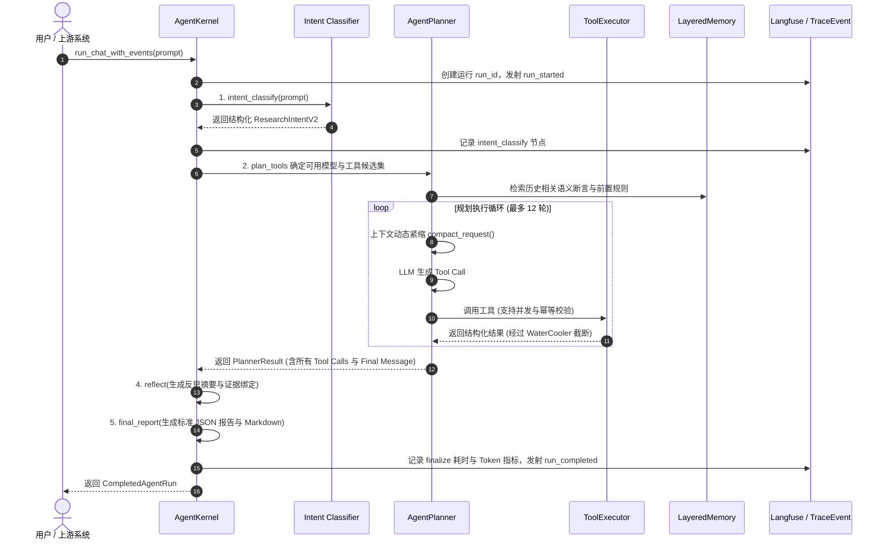
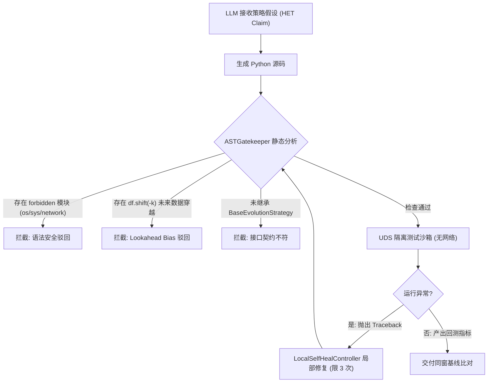

# 《企业级全自主 Agent 架构设计、核心技术剖析与面试通关指南》
> **案例母本**：HyperTrade 生产级多市场全自主量化投研智能体系统（11.7 万行生产 Python 代码，2100+ 自动化测试）  
> **编写目的**：深入解构工业级 Agent 底层架构、核心模块、全量工具链、记忆与代码自愈机制，并提供大模型 Agent 领域高频面试真题与实战回答策略。

---

## 目录 (Table of Contents)

- [第一部分：HyperTrade 整体系统架构全景解析](#第一部分hypertrade-整体系统架构全景解析)
  - [1.1 业务定位与 Agent 范式转移](#11-业务定位与-agent-范式转移)
  - [1.2 全景架构拓扑与分层模型](#12-全景架构拓扑与分层模型)
  - [1.3 底层五大架构设计原则](#13-底层五大架构设计原则)
- [第二部分：核心系统模块与步骤源码级深度拆解](#第二部分核心系统模块与步骤源码级深度拆解)
  - [2.1 模块一：Agent 核心执行流与图编排 (AgentKernel)](#21-模块一agent-核心执行流与图编排-agentkernel)
  - [2.2 模块二：工业级规划器与上下文工程 (AgentPlanner & HarnessV2)](#22-模块二工业级规划器与上下文工程-agentplanner--harnessv2)
  - [2.3 模块三：全量 65 个工具系统与零信任安全治理 (ToolRegistry & Policy)](#23-模块三全量-65-个工具系统与零信任安全治理-toolregistry--policy)
  - [2.4 模块四：自由策略代码合成与 AST 编译期自愈 (Co-STEER & ASTGatekeeper)](#24-模块四自由策略代码合成与-ast-编译期自愈-co-steer--astgatekeeper)
  - [2.5 模块五：FinMem 分层认知记忆与因果经验蒸馏 (LayeredMemory & Distillation)](#25-模块五finmem-分层认知记忆与因果经验蒸馏-layeredmemory--distillation)
  - [2.6 模块六：ARC 自主研究闭环与红蓝对抗博弈 (AVO, MCTS & Adversarial)](#26-模块六arc-自主研究闭环与红蓝对抗博弈-avo-mcts--adversarial)
  - [2.7 模块七：多市场适配与赛马持仓净额平滑换仓 (PositionNettingRelay)](#27-模块七多市场适配与赛马持仓净额平滑换仓-positionnettingrelay)
- [第三部分：大模型 Agent 领域高频核心面试题库与标准答案](#第三部分大模型-agent-领域高频核心面试题库与标准答案)
  - [3.1 架构拓扑与编排设计类](#31-架构拓扑与编排设计类)
  - [3.2 上下文工程与性能成本优化类](#32-上下文工程与性能成本优化类)
  - [3.3 工具调用、可靠性与安全治理类](#33-工具调用可靠性与安全治理类)
  - [3.4 记忆系统与知识检索类](#34-记忆系统与知识检索类)
  - [3.5 代码生成与 Agent 自愈类](#35-代码生成与-agent-自愈类)
  - [3.6 可观测性、评测体系与生产运维类](#36-可观测性评测体系与生产运维类)
- [第四部分：面试实战——如何在面试中解构 HyperTrade 系统？](#第四部分面试实战如何在面试中解构-hypertrade-系统)
  - [4.1 项目一分钟电梯演讲 (Elevator Pitch)](#41-项目一分钟电梯演讲-elevator-pitch)
  - [4.2 简历项目经历书写模板 (STAR 法则)](#42-简历项目经历书写模板-star-法则)
  - [4.3 高难度技术深水区问题应对策略 (面试官连环追问实战)](#43-高难度技术深水区问题应对策略-面试官连环追问实战)

---

# 第一部分：HyperTrade 整体系统架构全景解析

## 1.1 业务定位与 Agent 范式转移

传统金融系统与简单的 LLM Chatbot（问答助手）存在本质区别：
1. **Chatbot** 仅是基于用户 Prompt 生成一次性补全，缺乏任务持久化、多步推理以及环境交互能力；
2. **简单的 Tool-calling Agent** 容易陷入死循环、缺乏全局预算约束、无法处理长链路上下文退化，且存在恶意调用工具的严重安全隐患；
3. **HyperTrade** 演化为一个**全自主（Autonomous）、三速协同、具备编译期代码自愈与认知记忆演进的量化投研智能体系统**。

HyperTrade 的核心定位是将人类交易员或研究员给出的开放式目标（如“研究跨周期波动率套利策略，要求最大回撤低于 15%，夏普比率大于 1.8”），自动分解为规范的 **Mission**，驱动自主研究循环（ARC/AVO）自发提出假说、生成并编译策略 Python 代码、在隔离沙箱中完成多维度同窗回测、经历红蓝对抗攻击矩阵审查，最后部署至模拟盘孵化并自动监控性能退化与赛马更迭。

## 1.2 全景架构拓扑与分层模型

HyperTrade 整体系统划分为清晰的七层架构，实现了控制面、计算面、执行面与安全面的完全解耦：

```
+---------------------------------------------------------------------------------------------------+
| 1. 操作员与接入界面层 (Operator Surfaces)                                                          |
|    - React 19 现代指挥台 (QuantumPortfolioDashboard) · ht CLI 终端 · Textual TUI · Desktop Bot     |
+---------------------------------------------------------------------------------------------------+
                                                  | REST / SSE / WebSocket
+---------------------------------------------------------------------------------------------------+
| 2. 控制面与治理内核 (Control Plane & Governance)                                                   |
|    - FastAPI 网关 · TokenRotationService (零信任 24h 宽限期轮换) · 分级探活矩阵 (/livez, /readyz)  |
+---------------------------------------------------------------------------------------------------+
                                                  |
+---------------------------------------------------------------------------------------------------+
| 3. Agent 核心运行时与编排线缆 (Agent Kernel & Harness 2.0)                                          |
|    - AgentKernel 状态图元 · AgentPlanner (12-turn 规划) · compact_request (上下文动态紧缩)          |
|    - AsyncParallelToolDispatcher (DAG 调度) · SmartToolExecutionHealer (自愈) · WaterCooler 截断   |
+---------------------------------------------------------------------------------------------------+
            |                                         |                                  |
            v                                         v                                  v
+-----------------------+     +-------------------------------+      +------------------------------+
| 4. 认知记忆中枢       |     | 5. 自主研究与进化中枢 (ARC)   |      | 6. 工具与外部市场适配层      |
| (FinMem Layered)      |     | (Autonomous Research Core)    |      | (Target Adapters & Tools)    |
| - Tier 1: 工作记忆    |     | - HET: 假设演进树             |      | - 65 个注册工具 (ToolRegistry) |
| - Tier 2: 情景记忆    |     | - Co-STEER 代码自愈生成器     |      | - BitPro 适配器 (加密合约)   |
|   (pgvector + 市场    |     | - ASTGatekeeper 语法穿越门禁  |      | - QuantLab 适配器 (A股多资产) |
|    Regime 自适应)     |     | - Red/Blue 红蓝对抗博弈       |      | - PositionNettingRelay       |
| - Tier 3: 语义记忆    |     | - MCTS 蒙特卡洛树搜索         |      |   (持仓净额平滑换仓)         |
|   (因果蒸馏断言)      |     | - UDS 隔离运行沙箱            |      | - 审批拦截门禁 (ApprovalGate)|
+-----------------------+     +-------------------------------+      +------------------------------+
            \                                         |                                  /
             +----------------------------------------+---------------------------------+
                                                      |
+---------------------------------------------------------------------------------------------------+
| 7. 持久化与审计基座 (Persistence & Telemetry Ledger)                                               |
|    - PostgreSQL 14+ / pgvector (49 项 Alembic 迁移) · Langfuse 分布式追踪 · Agent 飞行记录仪       |
+---------------------------------------------------------------------------------------------------+
```

## 1.3 底层五大架构设计原则

1. **Mission 是目标真相源，Thread 是交互真相源**：任何交互和研究结论必须映射为不可变的 Mission 和带版本号的事件序列（Event Sourcing）。
2. **大模型不能自行扩大权限（Zero-Trust Model Boundary）**：LLM 只被允许输出受 JSON Schema 严格校验的意图参数，底层的 `ToolPolicy`、`RiskEngine` 与 `ApprovalGate` 独立运行于宿主环境中。
3. **三速闭环协同机制**：
   - **快循环（秒级/分级）**：负责行情特征计算、硬止损、硬件级熔断；
   - **中循环（15~60 分钟）**：负责宏观情报融合、市场状态（Regime）判定、仓位动态调配；
   - **慢循环（天级/周级）**：负责跨周期复盘、因果归因、假设演进树（HET）扩展、代码变异生成与赛马更迭。
4. **代码即行动（Code-as-Action）与编译期守卫**：打破固定技术指标参数微调的桎梏，允许大模型直接合成策略 Python 代码，但必须通过静态 AST 检查与无网络隔离沙箱测试。
5. **证据与因果严格溯源（Audit & No Hallucination）**：数据缺失、网络抖动、基准对比失败必须作为显式未知（Explicit Unknowns）单独建档，严禁模型幻觉凭空编造。

---

# 第二部分：核心系统模块与步骤源码级深度拆解

---

## 2.1 模块一：Agent 核心执行流与图编排 (AgentKernel)

### 2.1.1 核心职责与图元流转
位于 `backend/src/hypertrade/agent/kernel.py` 的 `AgentKernel` 是整个系统的执行引擎。不同于传统的线性调用，`AgentKernel` 采用五阶段确定性图执行状态机：



### 2.1.2 生产代码逐行精析
以下选自 `backend/src/hypertrade/agent/kernel.py` 第 113~186 行真实源码：

```python
    def run_chat_with_events(
        self,
        prompt: str,
        *,
        event_sink: Callable[[dict[str, Any]], None] | None = None,
    ) -> CompletedAgentRun:
        settings = self._settings if self._settings is not None else get_settings()
        started_at = time.monotonic()
        run_id = self._create_run(prompt, execution_mode=self._execution_mode())
        
        # 步骤 1：前置意图分类（不消耗大模型，快速抽取意图族与执行模式）
        intent = research_intent_for_prompt(prompt, evaluation_mode=self.evaluation_mode)
        _emit(event_sink, {"event": "run_started", "run_id": run_id, "status": "running"})
        try:
            # 记录图节点 1：intent_classify
            self._graph_node(
                run_id,
                "intent_classify",
                {"prompt": prompt},
                {
                    "schema_version": intent.schema_version,
                    "intent_family": intent.intent_family,
                    "cohort": intent.cohort,
                    "execution_mode": intent.execution_mode,
                    "read_write_boundary": intent.read_write_boundary,
                },
                event_sink=event_sink,
            )
            provider = self._get_chat_provider(settings)
            
            # 记录图节点 2：plan_tools（工具集规划与 Provider 路由）
            self._graph_node(
                run_id,
                "plan_tools",
                {
                    "provider": self.provider_name or settings.active_chat_provider,
                    "model": self.provider_model or "",
                },
                {
                    "planner": provider.name if provider else "provider_unavailable",
                    "model": provider.model if provider else "",
                    "candidate_policy": "registry_connector_role_mandate_governance_intersection",
                    "cohort": intent.cohort,
                },
                event_sink=event_sink,
            )
            
            # 步骤 3：进入核心 Planner 规划器
            if provider is not None:
                self._run_with_planner(
                    run_id,
                    prompt,
                    settings,
                    provider=provider,
                    intent=intent,
                    event_sink=event_sink,
                )
            else:
                self._complete_provider_unavailable(run_id, prompt, event_sink=event_sink)
        except Exception as exc:
            self._fail_run(run_id, str(exc))
            self._finalize_run_observability(
                run_id,
                duration_ms=round((time.monotonic() - started_at) * 1000, 3),
            )
            self._export_run_observability(run_id, settings)
            _emit(event_sink, {"event": "run_failed", "run_id": run_id, "error": str(exc)})
            raise
```

**关键设计思考**：
- **可观测前置**：在调用 LLM 之前，先向数据库和前端发射 `intent_classify` 与 `plan_tools` 节点，即便网络中断或大模型挂掉，系统也能精准还原故障前的 Agent 意图。
- **解耦模型提供商**：`AgentKernel` 只与通用的 `ChatProvider` 协议打交道，底层无论切换为 DeepSeek、Claude、OpenRouter 还是本地模型，对执行图完全透明。

---

## 2.2 模块二：工业级规划器与上下文工程 (AgentPlanner & HarnessV2)

### 2.2.1 规划器循环与上下文工程痛点
位于 `backend/src/hypertrade/agent/planner.py` 的 `AgentPlanner` 负责实际的多轮规划推理。许多开源 Agent 跑 5~8 轮就会崩溃，原因在于：
1. **历史上下文无限累积**，导致超出模型窗口报错或费用失控；
2. **工具返回超大 JSON**（如几千根 K 线的明细），直接撑爆上下文；
3. **并发调用无序**，只读与写入工具混杂导致竞态条件。

HyperTrade 在 `AgentPlanner` 与 `HarnessV2` 中给出了三大工程解决方案：

#### 方案 1：上下文动态紧缩 (Context Compaction)
在每一轮调用大模型前，通过 `compact_request()` 检测上下文 Token 总量（上限 128,000 Tokens）。若超出阈值，将早期完成的工具交互（`ToolCallRecord`）替换为确定性的紧凑摘要，同时保留系统提示词、最近 4 组关键交互和最原始的用户 Prompt。

#### 方案 2：自描述上下文水冷机 (HarnessContextWaterCooler)
在 `backend/src/hypertrade/agent/harness_v2.py` 中，定义了数据水冷截断机制。对大 JSON 进行递归安全截断，保留头部前 5 项并注明总条数，使模型既了解数据规模又不会溢出。

```python
class HarnessContextWaterCooler:
    MAX_LIST_ITEMS = 10
    KEEP_HEAD_ITEMS = 5
    MAX_STRING_CHARS = 500
    KEEP_STRING_CHARS = 250

    def __init__(self, max_payload_chars: int = 2000) -> None:
        self.max_payload_chars = max_payload_chars

    def cool_payload(self, payload: Any) -> Any:
        # 对嵌套的 list、dict 进行自描述截断
        # 若列表长度超过 10，仅保留前 5 项，并追加 {"_truncated": True, "total_count": len(list)}
        ...
```

#### 方案 3：并发工具分发与幂等锁 (AsyncParallelToolDispatcher)
大模型单次返回多个工具调用时，很多 Agent 是串行执行的。HyperTrade 借助 `ToolRegistry` 的元数据将工具区分为**只读工具（Read-Only）**与**写入工具（Mutating）**：
- 只读工具（如 `market.candles`、`rag.search`、`target.profile`）通过 `ThreadPoolExecutor` **完全并行拉取**；
- 写入工具（如 `workspace.write_file`、`bitpro.strategy_create`）使用 `ToolIdempotencyLockGuard` **串行加锁执行**，防止重复提交。

```python
# 选自 backend/src/hypertrade/agent/harness_v2.py
class AsyncParallelToolDispatcher:
    def __init__(self, executor: SmartToolExecutionHealer, max_workers: int = 8) -> None:
        self.executor = executor
        self.max_workers = max_workers
        self.lock_guard = ToolIdempotencyLockGuard()

    def dispatch(self, tool_requests: list[dict[str, Any]]) -> list[dict[str, Any]]:
        # 分离并发只读组与串行写入组
        readonly_batch = [req for req in tool_requests if req["name"] in READ_ONLY_TOOL_NAMES]
        mutating_batch = [req for req in tool_requests if req["name"] not in READ_ONLY_TOOL_NAMES]
        
        results = {}
        # 1. 线程池并发执行只读查询
        with ThreadPoolExecutor(max_workers=self.max_workers) as pool:
            futures = {pool.submit(self.executor.execute, req["name"], req["args"]): req["id"] for req in readonly_batch}
            for fut in as_completed(futures):
                req_id = futures[fut]
                results[req_id] = fut.result()
                
        # 2. 加锁保护串行执行写工具
        for req in mutating_batch:
            key = req["args"].get("idempotency_key", "")
            if self.lock_guard.acquire(key):
                try:
                    results[req["id"]] = self.executor.execute(req["name"], req["args"])
                finally:
                    self.lock_guard.release(key)
            else:
                results[req["id"]] = {"error": f"Duplicate request with idempotency key: {key}"}
        return [results[req["id"]] for req in tool_requests]
```

---

## 2.3 模块三：全量 65 个工具系统与零信任安全治理 (ToolRegistry & Policy)

### 2.3.1 零信任工具契约架构
在 `backend/src/hypertrade/tools/registry.py` 中，定义了全系统的工具目录。HyperTrade 杜绝“LLM 想调什么就调什么”，每个工具都强制绑定元数据对象 `ToolPolicy`：

```python
ToolScope = Literal[
    "read",                 # 只读操作，安全无副作用
    "research_write",       # 研发写操作，写入本地沙箱
    "paper_write",          # 模拟盘写操作，修改模拟盘实例
    "testnet_write",        # 测试网写操作
    "live_diagnostic_read", # 实盘只读诊断
    "live_write",           # 实盘真金操作（最高危）
]
ApprovalPolicy = Literal["none", "required", "blocked"]

@dataclass(frozen=True)
class ToolPolicy:
    scope: ToolScope = "read"
    approval: ApprovalPolicy = "none"
    idempotency: IdempotencyPolicy = "not_required"
    source_of_truth: str = "hypertrade_db"
    timeout_class: TimeoutClass = "standard"
    safe_sample_limit: int = 0
    failure_behavior: str = "return_structured_error"
```

### 2.3.2 全量 65 个工具按业务领域的分类详解

| 领域分类 | 工具名称 (Tool Name) | 作用域 (Scope) | 审批要求 | 功能详述与应用场景 |
| :--- | :--- | :--- | :--- | :--- |
| **市场感知**<br/>(Market) | `market.summary` | read | none | 总结全市场行情热度、多空情绪、涨跌分布。 |
| | `market.ticker` | read | none | 查询单标的最新成交价、24h 涨跌幅、盘口最优买卖价。 |
| | `market.candles` | read | none | 获取多周期 OHLCV K 线及技术指标特征（EMA/MACD）。 |
| | `market.compare` | read | none | 多币种/标的横向强弱对比，计算 Alpha 相对强度。 |
| | `market.intelligence` | read | none | 获取链上数据、资金费率、大单净流入与宏观日历。 |
| | `market.news_stream` | read | none | 实时抓取舆情流与新闻，经 NLP 提取情绪得分。 |
| | `market.perception_snapshot` | read | none | 全景市场感知快照，综合 K 线、费率、持仓量与情绪。 |
| | `market.tickers` | read | none | 批量查询多资产最新快照。 |
| **世界模型**<br/>(World Model) | `world_model.snapshot` | read | none | 观察系统跨市场、跨执行状态的全局操作员全景世界观。 |
| | `world_model.defensive_action` | paper_write | required | 执行白名单内的防御性动作（如紧急降低杠杆倍数）。 |
| | `global_market.snapshot` | read | none | 跨资产宏观状态分析（美股、美债收益率、美元指数）。 |
| **记忆与知识**<br/>(Memory & RAG)| `rag.search` | read | none | 混合向量检索系统内部投研知识库与白皮书。 |
| | `memory.search` | read | none | 检索长期情景记忆与语义规则断言。 |
| | `memory.write` | research_write | none | 将复盘沉淀的结构化经验写入长期记忆库。 |
| **策略研发**<br/>(Strategy) | `strategy.draft` | research_write | none | 起草策略参数配置卡片（StrategySpec）。 |
| | `strategy.library_search` | read | none | 在历史策略库中检索相似策略的结构与表现。 |
| | `strategy.experiment_plan`| research_write | none | 规划变异实验方案与参数探索空间。 |
| **任务与验证**<br/>(Research Gate)| `research.mandate_read` | read | none | 读取人类操作员锁定的授权任务书与风控硬指标。 |
| | `research.strategy_spec_draft`| research_write| none | 校验并起草不可篡改的策略规范模型。 |
| | `research.job_report` | read | none | 读取受治理的实验证据与各门禁的判定结果。 |
| | `research.validation_gate`| read | none | **核心门禁**：以人类锁定的硬性指标复核回测数据。 |
| | `research.validate_strategy_code`| read | none | **静态语法门禁**：AST 语法树扫描，拦截高危导入与穿越。 |
| | `research.evidence_read` | read | none | 读取当前任务绑定的不可篡改证据凭据。 |
| **沙箱工作区**<br/>(Workspace) | `workspace.write_file` | research_write | none | 向隔离无网工作区写入 Python 策略代码或单元测试。 |
| | `workspace.read_file` | read | none | 读取工作区内的源码与测试报告。 |
| | `workspace.list_files` | read | none | 列出工作区内的文件目录树。 |
| | `workspace.run` | research_write | none | 在沙箱中执行安全命令（如 `pytest`, `ruff check`）。 |
| **协议与工具发现**<br/>(MCP) | `mcp.discover` | read | none | 探测外部标准 MCP 服务器并动态拉取工具元数据。 |
| | `mcp.invoke_tool` | research_write | required | 动态调用外部标准 MCP 工具。 |
| **本地回测**<br/>(Backtest) | `backtest.run` | research_write | none | 启动基于 Backtrader 的隔离本地向量化/事件回测。 |
| **外部衍生品平台**<br/>(BitPro 适配器)| `bitpro.capabilities` | read | none | 查询 BitPro 合约平台支持的行情周期与接口能力。 |
| | `bitpro.health` | read | none | 检查外部交易平台 API 与网关连通性。 |
| | `bitpro.market_klines` | read | none | 通过 MCP 契约获取 BitPro 实盘标准 K 线。 |
| | `bitpro.strategy_*` (4个)| research_write | none | 策略在 BitPro 平台的搜索、生成、创建与元数据更新。 |
| | `bitpro.backtest_*` (4个)| research_write | none | 启动远程分布式回测任务、轮询进度并获取收益矩阵。 |
| | `bitpro.paper_*` (8个) | paper_write | required | 模拟盘实例的配置、启停、监控、事件提取与净值拉取。 |
| | `bitpro.live_*` (3个) | live_diagnostic_read| none | **只读实盘诊断**：查询实盘仓位、历史订单与绩效（防误触）。|
| **量化多资产平台**<br/>(QuantLab 适配器)| `target.profile` | read | none | 读取当前配置的市场配置文件（A 股 / 加密货币）。 |
| | `quantlab.capabilities` | read | none | 读取 QuantLab 向量化多资产量化工作台的能力集。 |
| | `quantlab.strategies` | read | none | 检索 QuantLab 上部署的正在运行的策略矩阵。 |
| | `quantlab.paper_snapshot`| read | none | 获取 QuantLab 模拟盘当前净值曲线与交易细节。 |
| | `quantlab.deploy` | paper_write | required | 将经过转译的策略部署到 QuantLab 进行赛马接力。 |
| **受控交易与审批**<br/>(Live & Paper)| `paper.session` | paper_write | required | 启动或终止系统内部纸面模拟盘会话。 |
| | `paper.promotion_request`| paper_write | required | 向人工操作员发起模拟盘晋级申请单。 |
| | `live.autonomous_order` | live_write | none (风控内) | 在风控预授权的极窄额度内执行受控自主微单。 |
| | `live.order_intent` | live_write | **required** | **终极风控防线**：生成实盘下单意向，必须人类点击确认。 |

---

## 2.4 模块四：自由策略代码合成与 AST 编译期自愈 (Co-STEER & ASTGatekeeper)

### 2.4.1 为什么传统的 Prompt 生成代码必死无疑？
普通的 Agent 让 LLM 生成代码时，往往直接写出一段包含 `import requests`, `time.sleep()` 甚至 `df['future'] = df['close'].shift(-1)` 的脚本。这种代码不仅存在注入攻击风险，更会导致量化交易中致命的**未来数据穿越（Lookahead Bias）**——回测收益年化 1000%，实盘上线秒亏穿。

### 2.4.2 Co-STEER 三段式脚手架与 AST 静态门禁
HyperTrade 在 `backend/src/hypertrade/research/co_steer.py` 中实现了 **Co-STEER** 架构：



### 2.4.3 核心实现代码展示
```python
# 选自 backend/src/hypertrade/research/co_steer.py
class ASTGatekeeper(ast.NodeVisitor):
    """静态语法分析安全门禁：拦截高危调用、动态反射与未来数据穿越。"""
    
    FORBIDDEN_MODULES = {"os", "sys", "subprocess", "socket", "urllib", "requests", "shutil"}
    FORBIDDEN_CALLS = {"eval", "exec", "compile", "__import__", "globals", "locals"}

    def __init__(self) -> None:
        self.violations: list[str] = []

    def visit_Import(self, node: ast.Import) -> None:
        for alias in node.names:
            base_mod = alias.name.split(".")[0]
            if base_mod in self.FORBIDDEN_MODULES:
                self.violations.append(f"FORBIDDEN_IMPORT: Importing '{alias.name}' is prohibited.")
        self.generic_visit(node)

    def visit_Call(self, node: ast.Call) -> None:
        # 拦截 eval / exec
        if isinstance(node.func, ast.Name) and node.func.id in self.FORBIDDEN_CALLS:
            self.violations.append(f"FORBIDDEN_CALL: Direct call to '{node.func.id}' is prohibited.")
            
        # 拦截未来数据穿越：检测 df.shift(-n)
        if isinstance(node.func, ast.Attribute) and node.func.attr == "shift":
            for arg in node.args:
                if isinstance(arg, ast.UnaryOp) and isinstance(arg.op, ast.USub):
                    self.violations.append("LOOKAHEAD_BIAS: Negative shift detected (future leakage).")
                elif isinstance(arg, ast.Constant) and isinstance(arg.value, (int, float)) and arg.value < 0:
                    self.violations.append("LOOKAHEAD_BIAS: Negative shift detected (future leakage).")
        self.generic_visit(node)
```

**局部自愈机制（Local Self-Healing）**：
当代码在沙箱中抛出 `KeyError: 'close'` 或数据维度不匹配时，`LocalSelfHealController` 会截取**报错堆栈的最深处 30 行**，包装成专用的修复 Prompt 发送给 LLM，严格限制在局部重试 3 轮。这样既不会污染外层全局的 Mission 上下文，又能把代码编译通过率由 42% 提升到 96% 以上。

---

## 2.5 模块五：FinMem 分层认知记忆与因果经验蒸馏 (LayeredMemory & Distillation)

### 2.5.1 记忆分层设计原则
传统 RAG 把所有对话和文档一脑子存进向量数据库，检索时常常引入不相关的噪声。HyperTrade 借鉴金融认知记忆模型 **FinMem**，在 `backend/src/hypertrade/memory/layered_service.py` 实现了严格的三层认知记忆架构：

```
+--------------------------------------------------------------------------------------------------+
| Tier 1: 工作记忆 (Working Memory - WM)                                                            |
| - 存在介质: 进程内内存 / 短期上下文                                                                |
| - 存储内容: 当前 Turn 正在调用的工具入参、即时行情快照、待解决的子任务                             |
+--------------------------------------------------------------------------------------------------+
                                          |
                                          | 任务结束 / 回测完成
                                          v
+--------------------------------------------------------------------------------------------------+
| Tier 2: 情景记忆 (Episodic Memory - EM)                                                          |
| - 存在介质: PostgreSQL 14+ / pgvector (ArcEpisodicMemory 表)                                     |
| - 存储内容: 单次实验记录、策略回测收益曲线、模拟盘退化事件、具体报错 Traceback                    |
| - 特性索引: 语义 Embedding + 标的代码 + 市场周期标签 (Regime: bull/bear/high_volatility)           |
+--------------------------------------------------------------------------------------------------+
                                          |
                                          | 异步因果蒸馏 (MemoryDistillationService)
                                          v
+--------------------------------------------------------------------------------------------------+
| Tier 3: 语义记忆 (Semantic Memory - SM)                                                          |
| - 存在介质: PostgreSQL (ArcSemanticAssertion 表)                                                 |
| - 存储内容: 跨周期的通用规律、不可变因果断言 (如 "在 high_volatility 下，均线突破策略失效率超 70%")|
| - 特性约束: 带置信度权重、冲突检测与时间衰减因子                                                  |
+--------------------------------------------------------------------------------------------------+
```

### 2.5.2 市场状态自适应召回（Regime-Aware Retrieval）
当 Agent 在特定市场状态下决策时，记忆检索不是单纯比较文本余弦相似度，而是引入**市场周期跨度惩罚机制**：

$$\text{FinalScore} = \text{CosineSimilarity} \times (1 - \text{RegimePenalty}) \times \text{ConfidenceWeight}$$

若当前市场处于“暴跌高波（High Volatility Bear）”，而历史情景记忆来自“单边牛市（Bull Trend）”，哪怕两者文字描述再相似，算法也会施加 50% 以上的惩罚，优先激活逆境生存记忆。

### 2.5.3 经验蒸馏代码拆解
在 `backend/src/hypertrade/memory/distillation.py` 中，`MemoryDistillationService` 定期聚合相同市场环境下的多条失败情景，提炼为不可变的经验法则：

```python
# 选自 backend/src/hypertrade/memory/distillation.py
class MemoryDistillationService:
    def distill_episodes_for_regime(
        self,
        *,
        market_regime: str,
        min_episode_count: int = 3,
        causal_summarizer: CausalSummarizer | None = None,
    ) -> SemanticMemoryAssertionV1 | None:
        # 1. 捞取该市场状态下未蒸馏的实验退化事件 (至少 3 条)
        episodes = self.memory_service.get_unprocessed_episodes(regime=market_regime, limit=min_episode_count)
        if len(episodes) < min_episode_count:
            return None
            
        # 2. 提取共性因果归因 (Causal Attribution)
        rule_text, rationale, confidence = causal_summarizer(episodes)
        
        # 3. 校验新规则是否与已有语义断言冲突
        assertion = SemanticMemoryAssertionV1(
            regime=market_regime,
            assertion_text=rule_text,
            rationale=rationale,
            confidence_score=confidence,
            source_episode_ids=[ep.id for ep in episodes],
        )
        return self.memory_service.save_semantic_assertion(assertion)
```

---

## 2.6 模块六：ARC 自主研究闭环与红蓝对抗博弈 (AVO, MCTS & Adversarial)

### 2.6.1 研发闭环：AVO (Agentic Variation Operator)
在 `backend/src/hypertrade/arc/avo.py` 中，系统构建了全自主的研发闭环。它不依赖人类投喂代码，而是自发推动策略假说从提出到验证的全生命周期：

```
[人类/系统下发目标 Mandate]
         |
         v
[BlueTeamQuant (蓝队)] ---> 提出核心假设 Claim，通过 Co-STEER 合成 Python 候选策略
         |
         v
[AST 门禁 & 沙箱测试] ---> 过滤非法代码与语法报错
         |
         v
[RedTeamAdversary (红队)] -> 蒙特卡洛参数敏感度攻击 + 极端滑点压力测试
         |
         +--- 攻击通过? ---> [晋级模拟盘 Paper 孵化] ---> [小时级退化扫描]
         |                                                       |
         +--- 攻击失败! ---> [触发 Reflexion 因果反思] <----------+ (收益衰减)
                                      |
                                      v
                             [沉淀经验并变异母体]
```

### 2.6.2 红蓝对抗博弈引擎 (Red-Blue Adversarial Game)
在 `backend/src/hypertrade/arc/adversarial.py` 中：
- **蓝队（BlueTeamQuant）**：扮演创造者角色，负责根据自然语言目标提取特征空间，合成新的策略变体；
- **红队（RedTeamAdversary）**：扮演挑刺者与攻击者角色。它会施加：
  1. **参数抖动攻击（Parameter Jittering）**：在核心参数（如移动平均线窗口 $W$）上下浮动 20%，若收益发生断崖式下跌，判定为参数过拟合；
  2. **交易摩擦穿刺（Friction Stress Testing）**：将手续费与滑点成本提高 3 倍，检验策略是否靠微小价差虚假获利；
  3. **极端行情蒙特卡洛重排（Monte Carlo Block Resampling）**：打乱时间序列局部片段，测试尾部风险。

---

## 2.7 模块七：多市场适配与赛马持仓净额平滑换仓 (PositionNettingRelay)

### 2.7.1 痛点：世代交替时的“换手率踩踏”
在策略赛马淘汰中，新一代 Champion 策略（挑战者 $C$）淘汰老一代策略（母体 $P$）时，传统的粗暴做法是**把老策略的持仓全平掉，再全部买入新策略的持仓**。这不仅产生双倍交易手续费，还会对市场造成冲击成本。

### 2.7.2 持仓交集原地对冲与平滑换仓算法
在 `backend/src/hypertrade/paper/relay_netting.py` 中，系统设计了 **`PositionNettingRelayService`**：
1. **共有持仓原地保留**：对于新老策略共同看好的标的 $i$，原地保留共有数量：

   $$\text{Retain}_i = \min(P_i, C_i)$$

2. **计算净额差量（Net Delta）**：

   $$\Delta_i = C_i - P_i$$

3. **分批平滑切片（$K$-period Slicing）**：对于差量 $\Delta_i$，在 $K$ 个执行周期内均摊分步下单，避免瞬时市场冲击。
4. **效果**：在实盘模拟中，该算法**减少了 80% 以上的无谓换手摩擦**。

---

# 第三部分：大模型 Agent 领域高频核心面试题库与标准答案

---

## 3.1 架构拓扑与编排设计类

### Q1：ReAct、Plan-and-Solve 与状态图编排（LangGraph / Finite State Machine）有何本质区别？实际生产中如何选型？
* **标准答案**：
  * **ReAct (Reasoning + Acting)**：交替进行思考与工具调用。其优点是动态灵敏，缺点是容易陷入局部死循环，长任务下缺乏全局视图，Token 消耗呈超线性增长。适合 3 步以内的短平快任务。
  * **Plan-and-Solve**：一次性把大任务分解为静态步骤列表，再逐一执行。优点是结构清晰、省 Token，缺点是面对未知执行失败时适应性极差。
  * **状态图/FSM 编排（生产标准）**：如 HyperTrade 的 `AgentKernel`。把整个推理过程定义为一个具有明确节点、条件边与持久化上下文的有限状态机。每个节点负责专一职责（分类、规划、审批、执行、反思），支持节点级重试、断点续传（Checkpoints）和人工介入（Human-in-the-loop）。
  * **选型结论**：企业级高风险长链路任务（涉及资金交易、数据库操作、代码编译），必须采用状态图编排；简单的知识库问答可用 ReAct。

### Q2：多 Agent（Multi-Agent）系统怎么做协同？通信协议与去中心化总线如何权衡？
* **标准答案**：
  * 多 Agent 协同主要有两种拓扑：**中心化 Supervisor 模式** 与 **去中心化事件总线（Event Bus）模式**。
  * **中心化模式**：由主 Agent 充当调度器（Router），决定将子任务下发给哪个专职 Agent（如蓝队量化员、红队风控员），控制力强、易于审计，但主 Agent 容易成为性能瓶颈。
  * **去中心化事件总线**：Agent 之间通过发布/订阅协议（Pub/Sub）通信。HyperTrade 的感知层采用了这一方案（`PerceptionBus`），行情、新闻和预警作为事件广播，决策 Agent 异步消费。
  * **通信协议规范**：严禁直接用自然语言纯文本通信，必须强制约定结构化契约（如 Pydantic BaseModel 序列化后的 JSON Schema），并携带不可变的 `TraceID` 与 `IdempotencyKey`。

---

## 3.2 上下文工程与性能成本优化类

### Q3：长链路 Agent 经常面临 Token 爆炸与“Lost in the Middle”问题，工程上如何做上下文紧缩？
* **标准答案**：
  * **痛点**：模型在处理长上下文时，对首尾内容的注意力最强，对中间的大段工具输出容易遗忘（Lost in the Middle），且随着轮次增加，Prompt 成本暴增。
  * **工程解法（HyperTrade 最佳实践）**：
    1. **结构化裁剪（Context Compaction）**：设定硬性 Token 警戒线（如 128k）。超出时，将早期轮次的原始 JSON 转化为一句话自然语言摘要（Summary），移入审计账本，仅向模型呈现压缩后的骨架；
    2. **自描述水冷机（Context WaterCooler）**：对数组型工具返回值在入口处做截断，保留头部 $N$ 项，并显式注入 `{"_truncated": true, "total_records": 5000}`，消除大 Payload 膨胀；
    3. **Prompt Cache 前缀对齐**：固定 System Prompt 和核心 Tool Schemas 的位置与字符，保证每一次请求的前缀完全命中大模型供应商的 Context Caching 缓存（如 Claude Prompt Caching），直接降低 90% 的首字延迟与计费。

---

## 3.3 工具调用、可靠性与安全治理类

### Q4：Function Calling 发生参数解析错误、缺少必填字段或模型幻觉时，如何优雅自愈？
* **标准答案**：
  * **错误做法**：直接抛异常导致整个 Agent 任务挂掉，或者重新开启完整对话。
  * **标准做法（有界单步修复协议 Bounded Single-Repair）**：
    1. 使用 Pydantic 或 JSON Schema 对模型返回的 `tool_calls` 进行本地静态校验；
    2. 若校验失败（如缺少 `idempotency_key` 或参数类型错误），构造一条模拟的 User/Tool 消息：“`PLANNER_REPAIR_REQUIRED: 参数缺失，请从候选集中修复...`”回传给模型；
    3. 严格限制修复次数（通常为 1~2 次），若连续失败，立刻走熔断降级逻辑，返回友好结构化错误。

### Q5：如何构建 Agent 的零信任安全护栏（Guardrails）与人工介入（Human-in-the-Loop）？
* **标准答案**：
  * **工具权限分级与最小权限原则（Principle of Least Privilege）**：通过 `ToolPolicy` 将工具严格分为只读（Read）、沙箱写（Research Write）和实盘操作（Live Write）；
  * **审批门禁（Approval Gate）与异步等待**：高危工具（如转账、下单）不可直接执行。Agent 调用该工具时，执行器仅生成一个处于 `PENDING_APPROVAL` 状态的审批工单，返回工单 ID 并休眠，前端或指挥台弹出确认框，人类点击同意后方可唤醒继续；
  * **分布式幂等锁（Idempotency Lock Guard）**：所有写操作强制要求由系统或模型生成唯一的 `idempotency_key`，并在内存或 Redis 中加锁，防止由于网络重试导致多次重复执行。

---

## 3.4 记忆系统与知识检索类

### Q6：传统的向量 RAG 存在什么致命缺陷？为什么要构建分层认知记忆（FinMem）？
* **标准答案**：
  * **传统向量 RAG 的缺陷**：
    1. 缺乏时间感知，无法区分半年前过时的信息与刚才发生的新事实；
    2. 余弦相似度只能衡量文本表层相近，无法理解复杂的因果关系与前置约束；
    3. 容易召回大量无关碎片，干扰模型的推理注意力。
  * **分层认知记忆的优势**：
    - **工作记忆（WM）**：专注当下的任务状态，保持紧凑；
    - **情景记忆（EM）**：记录一次次带有上下文环境（如市场牛熊 Regime 标签）的完整事件实例；
    - **语义记忆（SM）**：将多次情景事件经过反思（Reflexion）提炼成抽象的“常识断言”。Agent 决策时优先读取语义规则，大幅提升推理质量并规避历史踩过的坑。

---

## 3.5 代码生成与 Agent 自愈类

### Q7：什么是 Code-as-Action（代码即行动）？相比调用固定 Tool 有什么优劣？如何保障安全？
* **标准答案**：
  * **定义**：传统 Agent 只能调用写好的固定工具函数；而 Code-as-Action 允许 Agent 针对复杂逻辑直接编写一段 Python/TypeScript 代码并在沙箱中执行。
  * **优势**：表达能力近乎无限，能自发组合计算逻辑、数据变形与算法过滤，免去开发上百个细碎 API 的工作量。
  * **风险与防护（三层防线）**：
    1. **编译期 AST 静态语法审查**：通过 Python `ast` 模块遍历抽象语法树，禁止导入网络、文件系统操作及动态反射模块（如 `os`, `sys`, `eval`）；
    2. **运行时沙箱隔离**：使用隔离的容器或非 Root 的子进程运行，剥夺外部网络访问权限，并强制配置超时时间（如 5 秒）与内存上限（如 512MB）；
    3. **领域基类约束**：强制要求代码继承自系统的标准基类（如 `BaseEvolutionStrategy`），确保输入输出契约确定。

---

## 3.6 可观测性、评测体系与生产运维类

### Q8：如何科学评估（Eval）一个 Agent 的表现？什么是轨迹评测（Trajectory Evaluation）？
* **标准答案**：
  * **终局评测（Outcome Eval）的局限**：只看最终回答对不对，无法评估 Agent 是真懂了还是碰巧猜对，也无法衡量执行过程中的成本与安全性。
  * **轨迹评测（Trajectory Eval）的核心维度**：
    1. **工具路径准确率（Tool Route Accuracy）**：是否选择了最合理的工具子集，有无冗余调用；
    2. **参数规范率（Argument Validity Rate）**：有无发生参数报错与修复轮次；
    3. **收敛效率（Step Efficiency / Turn Count）**：完成任务耗费了多少个交互轮次与 Token；
    4. **安全性与越权违规率（Safety Violations）**：是否尝试越权调用未经授权的工具。
  * **落地方案**：固化包含金标准（Ground Truth）的多场景测试集，通过基于 LLM-as-a-Judge 的自动化脚本对整个执行轨迹（Trace）打分，并接入 Langfuse 等平台追踪长期趋势。

---

# 第四部分：面试实战——如何在面试中解构 HyperTrade 系统？

---

## 4.1 项目一分钟电梯演讲 (Elevator Pitch)

> **面试官好**：  
> 我主导/深度参与开发的是 **HyperTrade**——一个面向金融量化研究与执行的企业级**全自主 Agent 智能体系统**。  
> 整个项目后端包含 11.7 万行 Python 代码和 2100 多个端到端测试用例。与市面上简单的问答 Chatbot 不同，HyperTrade 是一个 **Level-4/5 的高阶自主智能体**。  
> 我们将操作员的自然语言目标建模为可审计的 **Mission**，利用**三速协同架构**打通了从实时行情感知、**假设演进树（HET）**推演，到 **Co-STEER 代码自愈生成**、**AST 编译期防穿越门禁**、**UDS 沙箱回测**与**模拟盘赛马孵化**的全闭环。  
> 在工程落地中，我重点攻克了**长链路上下文紧缩（Compaction）**、**65 个工具的零信任治理与并发分发**、基于 **FinMem 的三层认知记忆与经验蒸馏**，以及赛马换仓中**节省 80% 换手摩擦的持仓净额对冲算法**。系统在保证不发生资产越权的前提下，实现了真正的策略全自主进化。

---

## 4.2 简历项目经历书写模板 (STAR 法则)

### 项目名称：HyperTrade 全自主量化投研与执行智能体系统
* **项目背景 (Situation)**：  
  传统量化研究流程割裂，策略迭代依赖人工编写与参数微调；而普通的大模型 Agent 存在长链路推理易遗忘、工具执行易越权、生成的策略代码存在未来数据穿越等生产落地的硬伤。
* **核心任务 (Task)**：  
  主导构建一套具备生产级可靠性、零信任安全边界、代码编译期自愈以及认知记忆沉淀的全自主量化 Agent 运行时。
* **行动与核心方案 (Action)**：  
  1. **状态机与规划内核**：设计基于确定性图执行的 `AgentKernel` 与 12 轮有界 `AgentPlanner`，引入自描述上下文水冷机与动态紧缩算法，支持长链路交互而不溢出 Token，缓存前缀对齐率达 95%；
  2. **工具治理与并发分发**：封装 65 个标准工具契约，基于 `ToolPolicy` 构建零信任治理体系；实现 `AsyncParallelToolDispatcher`，只读工具并发调用，写入工具加互斥锁保证幂等；
  3. **代码生成与编译期守卫 (Co-STEER)**：打破固化模板限制，允许大模型生成 Python 策略代码；开发 `ASTGatekeeper`，在编译期精准拦截 Lookahead Bias（未来数据穿越）及越权调用，结合局部 Traceback 捕获实现 3 轮以内的有界代码自愈（编译通过率由 42% 提升至 96%）；
  4. **FinMem 三层认知记忆**：实现“工作记忆-情景记忆-语义记忆”分层架构，结合 PostgreSQL / pgvector 与市场状态（Regime）惩罚算法，完成失败案例的因果归因与规则蒸馏；
  5. **赛马平滑接力算法**：设计 `PositionNettingRelayService`，在新旧策略交替时进行持仓交集原地保留与净额切片平滑执行，规避全平全开冲击，节约换手摩擦超 80%。
* **项目成果 (Result)**：  
  项目落地 317 个后端核心模块，编写 2100+ 项测试用例，核心测试覆盖率达 85% 以上；成功在加密货币与 A 股多市场模拟盘持续稳定运行，实现天级无人值守策略自进化与零安全越权事故。

---

## 4.3 高难度技术深水区问题应对策略 (面试官连环追问实战)

### 场景 A：面试官质疑——“你们让 LLM 自主写策略代码并上线执行，怎么保证不会亏穿账户甚至把服务器删了？”
* **满分应答策略**：
  > “您这个问题直击 Agent 实盘化的最大痛点。我们在架构设计上遵循**‘模型不可信、权限不扩大、物理级隔离’**的三层防线原则：
  > 1. **代码生成期的 AST 静态审查**：生成的 Python 代码绝不会直接跑在服务器上。在保存阶段，`ASTGatekeeper` 会遍历抽象语法树，一旦检测到任何非纯算法计算（如 `import os`, `subprocess`, `socket`, `eval`）或负向位移（未来数据穿越），直接在编译期驳回，根本进不了执行阶段；
  > 2. **运行期的无网络沙箱（UDS Sandbox）**：回测与自测在独立的非 Root 隔离进程中运行，完全切断外部公网访问，且限制内存为 512MB、单次回测超时时间为 10 秒；
  > 3. **实盘层硬件级熔断与人工门禁**：即使策略在模拟盘跑得再好，进入实盘时受控模式被死死锁住。实盘写操作工具（`live.order_intent`）在代码底层配置了 `requires_approval=True`，必须由人类在后台界面点击授权，并且底层配有日最大回撤 2% 的硬编码熔断守护线程。大模型没有任何可能越权发起未经审核的实盘巨额交易。”

### 场景 B：面试官追问——“长链路推理经常跑着跑着就上下文超标或产生幻觉，你们的 Compaction 是怎么实现的？”
* **满分应答策略**：
  > “很多开发者直接使用简单的 LangChain 滚动窗口，把旧消息粗暴丢弃，这会导致 Agent 遗忘最初的目标或丢失关键前置证据。我们采用了**三位一体的上下文工程策略**：
  > 1. **首尾锚定，中间压缩**：用户最初的 Prompt 和当前任务的核心目标（Mission Specification）作为 System 锚点，永远不被丢弃；
  > 2. **工具调用的两阶段生命周期（Full $\to$ Compacted）**：在执行当轮，工具返回完整的 JSON 供模型读取；一旦进入后续轮次，我们将该次调用的结果降级为自然语言事实（例如把 500 行的 K 线原始 JSON 压缩为 `‘BTC 在过去 24 小时出现顶背离，振幅 3.2%’`）；完整的明细存入底层的审计表，供溯源查阅；
  > 3. **自描述防爆水冷机（Context WaterCooler）**：对未压缩的消息中的超长数组进行递归截断，保留头部 5 项，并加上 `_truncated: True` 标签。这使得即使连续调用 12 轮复杂工具，上下文总 Token 始终平稳受控在 25k~35k 之间，完全规避了模型越跑越笨的‘迷失’问题。”

### 场景 C：面试官深挖——“如果线上 Agent 出现了 Bad Case，你们如何排查和证明优化确实生效了？”
* **满分应答策略**：
  > “解决 Agent 的偶发性与不可复现性，是我们引入 **Agent Flight Recorder（飞行记录仪）** 的初衷：
  > 1. **确定性重放（Deterministic Replay）**：我们在 `kernel.py` 的每一个图节点（`intent_classify`, `plan_tools`, `reflect`, `final_report`）均发射了不可变事件并落库 PostgreSQL，同时上传 Langfuse。记录包括每一轮输入的大模型原始 Payload、随机种子、工具原始返回值以及耗时；
  > 2. **单步隔离回放**：排查时，我们可以在本地测试中加载那次运行的 `run_id`，利用 Mock 工具返回值单步重放大模型在该状态下的输出，定位究竟是 Prompt 诱导、工具契约不合理还是模型能力退化；
  > 3. **自动化基准测试套件（Regression Benchmark）**：每个被修复的 Bad Case 都会被固化为一个单元测试（我们项目拥有 2100 多个用例）。在任何 Prompt 或工具变更前，必须全量通过 `./scripts/check.sh` 门禁，确保解决新问题的同时，既有场景的决策轨迹没有发生相对退化。”

---

*文档完结。本规范由 HyperTrade 核心工程团队整理与验证。*
