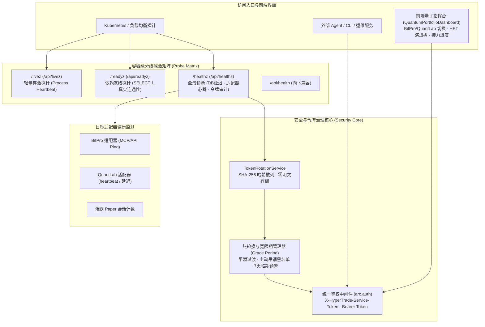

# 67 生产级可观测性探活、安全令牌动态轮换与量化多目标指挥台架构设计

> 状态：设计规范与实施快照（Approved Technical Specification）  
> 日期：2026-10-06  
> 关联规范：Spec 031 (QuantLab 看板与 HET 假设演进树), Spec 032 (运维探活与安全令牌管理)

---

## 1. 架构演进背景

随着 HyperTrade 从单体研究原型走向多目标（Crypto + A 股）企业级部署，系统面临高可用运维与高等级安全的两大核心挑战：
1. **容器云就绪度与细粒度故障诊断**：传统的单一 `/api/health` 端点无法区分“容器存活（Liveness）”、“数据库及依赖就绪（Readiness）”与“包含外部适配器连通性的全景健康度（Comprehensive Diagnostics）”。在 Kubernetes / Docker Swarm 或云原生负载均衡下，缺乏标准化的分级探针会导致容器误杀或流量过早打入未就绪实例。
2. **凭据安全与零停机轮换（Zero-Downtime Secret Rotation）**：Agent 平台与外部消费方（外部 Agent、TUI、监控、CI/CD）通信需高权限服务令牌。传统静态硬编码或明文存储存在泄漏与单点风险；急迫吊销会导致调用方瞬间雪崩中断。
3. **多市场混合统一指挥**：操作员需要在一个控制台统一管理 BitPro（加密货币合约）与 QuantLab（A 股多资产），直观掌控 RD-Agent 假设演进树（HET）系谱分化与赛马接力换仓进度。

为此，系统确立了生产级分级探活矩阵、动态安全令牌轮换引擎与多市场量化指挥台体系。

---

## 2. 总体架构拓扑

---

## 3. 容器级分级探活矩阵

为了满足云原生编排要求，系统在 `backend/src/hypertrade/main.py` 实现了分级探针，并同时挂载于根路径（如 `/healthz`）与 API 路径（如 `/api/healthz`）：

### 3.1 探活探针规约

| 探针路径 | 检查目标 | 判定逻辑 | 正常返回 | 故障返回 | 适用编排场景 |
| --- | --- | --- | --- | --- | --- |
| `/livez` | 进程存活 | FastAPI 事件循环健康响应 | 200 `{"status": "alive"}` | 500 / 超时 | K8s `livenessProbe`（失败则重启容器） |
| `/readyz` | 依赖就绪 | 数据库真实执行 `SELECT 1` | 200 `{"status": "ready"}` | 503 `{"status": "not_ready", "database": "error"}` | K8s `readinessProbe`（失败则摘除流量） |
| `/healthz` | 全景诊断 | DB 延迟、适配器心跳、Worker 存活、构建标识、Paper 会话与令牌状态 | 200 全息 JSON 诊断树 | 503 全景诊断失败树 | 监控系统采集、灰度检查、巡检报警 |
| `/version` | 构建标识 | 读取随发布树打入镜像的 `BUILD_INFO`（提交 SHA；未打标记时为 `null`） | 200 `{"service","version","sha","stamped"}` | — | 发布流程在部署后比对线上 SHA 与刚发布的提交 |

### 3.2 适配器心跳与外部连通性探测
在 `QuantLabTargetAdapter` 与 `BitProTargetAdapter` 注入统一的 `heartbeat()` 探测方法：
- **QuantLab**：探测远端 MCP 或仿真进程连通性，上报毫秒级延迟；
- **BitPro**：调用健康检查端口上报服务连通状态；
- 全景健康报告实时输出 `adapters: {"quantlab": {"status": "ok", "latency_ms": 12.4}, "bitpro": {"status": "ok"}}`，一旦主数据库或核心适配器发生严重断联，健康探针即时返回 HTTP 503 并携带精准错误堆栈。

### 3.3 Worker 存活心跳、循环监督与构建标识

**Worker 存活。** worker 是独立进程，API 只能通过数据库了解它：`worker_heartbeats` 表（迁移 0052）每个 worker 一行
（`HYPERTRADE_WORKER_ID`，默认 `worker`），worker 每 30 秒刷新一次。记录的内容只有运维遥测：每个循环的最近成功／失败时间、
连续失败数、累计失败数、监督器重启数、最近一次失败的异常**类型**（不保存异常消息，它可能带有密钥或业务数据）；以及进程级的
事件循环滞后（定时器比预期晚醒多久，取最近约 5 分钟窗口的最坏值，同步调用堵住事件循环时会直接体现在这里）。

**事件循环看门狗。** `runtime/loop_watchdog.py` 在独立线程里每 0.5 秒让事件循环确认一次回调；确认晚于 3 秒时抓取事件循环线程的
调用栈（长时间停摆每 15 秒重采样一次）。`/healthz` 的 `workers[].last_stall` 给出停摆秒数、距今多久和正在运行的函数
（`文件:行 函数`，最深的在前，不含源码和变量值，最多 12 帧），`stalls_total` 是停摆次数。心跳刷新用独立线程，不与 ARC／AVO 的
长步骤共用线程池，否则繁忙的 worker 会被误判为过期。2026-11-10 部署后它暴露了启动时堵塞 95.954 秒、之后约 11 秒：根因是行情快照在事件循环线程里
逐条写库（约 700 条 × 每条 3 次数据库往返），现已改为线程中的单事务批量写入（见 `07-okx-market-data.md`）。

**停摆证据。** 循环线程的栈只在「循环自己在跑同步代码」时才指向责任方。#105、#107 之后生产里仍然每小时约 70～100 次、每次 3～14 秒的停摆，
循环线程的栈要么是空闲的 `select`，要么散落在毫不相干的位置（`socket.gethostname()`、SQLAlchemy 的 `_cloned_set`、deflate 的 `decode`……），
它是被别的线程占着 GIL、或整个进程没有拿到 CPU 时的受害者。看门狗因此在停摆结束时再记一份证据，写进 `last_stall`，并把原因累计到 `workers[].stall_causes`
（只存 `文件:行 函数` 和数字，不存源码和变量值；`runtime/stall_evidence.py`）：

- `scope`：`process` 表示看门狗线程自己离开轮询超过阈值（GIL 被占或进程没被调度），`loop` 表示只有事件循环没有应答。占 GIL 的 C 调用结束后事件循环常常先
  补跑积压的确认回调，看门狗再算时差已经小于阈值，这类停摆过去根本不会被记录，现在按看门狗自己离开轮询的时间计入。该时间从上一次轮询**开始**算起，
  所以落在轮询中途的占用（每次读 `/proc` 都会放掉 GIL）也算；读计数在一个独立的采样线程里做，看门狗自己的轮询只做最轻的事，不会因为别的线程忙而变晚。
- `threads`：循环线程（`loop: true`）加上最可能的 3 个线程，各带线程名、停摆期间的 CPU 秒数（Linux 的线程 CPU 时钟）和栈。`stack_source` 为 `dump`
  时栈是 faulthandler 的 C 线程在停摆**进行中**抓的（它不需要 GIL，占 GIL 的函数会出现在里面；超时取「阈值减两个轮询间隔」，保证比阈值更早触发；
  转储写在内存文件 `memfd` 里，磁盘被限速也不会冻住解释器；可用 `HYPERTRADE_STALL_DUMP=0` 关闭），为 `sample` 时是看门狗在停摆之后才采的样。
  非 Python 创建的线程（BLAS、Arrow）看不到栈，只体现在 `cpu.process_seconds` 与各线程 CPU 之和的差里。动态生成的代码（`<string>`、`<candidate>`）
  的函数名一律显示为 `<dynamic>:行 <code>`。
- `gc`（窗口内垃圾回收的次数、总暂停、最慢一次及其代数，来自 `gc.callbacks`）、`cpu`（进程 CPU 秒数、循环线程在运行队列里等 CPU 的秒数；注意这是等 CPU，
  不是等 GIL）、`host`（系统 CPU／内存／IO 压力的停滞秒数、CPU 被宿主机偷走的秒数、缺页和被抢占次数）：用来区分「某个线程占着 GIL」「垃圾回收」和
  「主机没给 CPU」。
- `cause`（一个原因要解释半数以上的停摆时长）：`gc`；`loop_busy`（循环线程自己在跑同步代码；`process` 范围时是循环线程里一次占 GIL 的长调用）；
  `cpu_starved`（循环线程可运行但在等 CPU，主机、别的进程或别的线程占着）；`other_thread`（仅 `process` 范围：另一个线程占了半数以上的时间，同时看门狗也被卡住，
  所以它占着 GIL，它的栈第一帧就是发起长调用的函数）；`cpu_contention`（仅 `process` 范围：没有单个线程过半，但几个线程合起来过半，GIL 车队）；
  `busy_pool`（仅 `loop` 范围：看门狗正常、循环没应答、别的线程在用 CPU，循环可能被它们饿着，也可能卡在自己的调用里，栈会说明）；`native_threads`
  （Python 不认识的线程占了 CPU）；`host_pressure`（进程几乎没跑，而宿主机的 steal 或 PSI 压力说明是主机的问题）；`no_cpu`（`process` 范围：进程几乎没用 CPU，
  可能是占着 GIL 却在等待的调用、IO、换页，或主机没调度它，看 `threads` 和 `host`）；`loop_blocked`（`loop` 范围：循环线程卡在一次调用里，栈会点出是哪个）；
  `unknown`（这个系统读不到线程 CPU）。判据见 `stall_evidence.classify`，原始数字就在旁边，可以自己复核。
- 停摆期间的每次采样（首次约在 3 秒时，之后每 15 秒一次）都带一份「到目前为止」的证据（`ongoing: true`），结束时被最终证据替换，只有最终证据才计入 `stall_causes`，所以一次不结束的挂死也能被解释。
- `workers[].process`：Python 版本、CPU 核数、线程数、常驻内存和各代垃圾回收的累计次数、暂停与阈值（阈值能看出是哪种回收器：Python 3.14 的增量 GC 是 `[2000, 10, 0]`），是读停摆时的背景。
- `workers[].process.arc_cache`：这个进程常驻的 ARC 任务数和事件数，以及按任务状态的拆分（`missions`、`events`、`by_state`）。完整垃圾回收要遍历所有存活对象，停摆的长短由常驻的堆决定，而 ARC 任务的大头是事件日志；2026-11-11 的根因就是周期扫描把全部任务（含早已结束的）的日志缓存进 `store.MISSIONS`，约 2 GB，一次完整回收近 10 秒（最长 18 秒）（见 `docs/progress.md`）。现在周期扫描用 `peek_controller` 读而不缓存，只缓存正在工作的任务；这个数字应当只剩进行中和待评审的任务，若重新长大，`by_state` 会指出是哪类状态的任务，`last_stall.threads` 的栈会指出是谁在读。

`/healthz` 的 `workers.status`：`alive`；`stale`（超过 3 分钟没有心跳）；`unknown`（还没有 worker 上报过，**不算故障**）。
整体状态在 worker `stale` 或某个循环连续失败 ≥ 3 次时变为 `degraded`；超过 24 小时没有上报的 worker 行视为已下线。
上报与读取都不会抛异常，遥测本身不能让 worker 或 API 出问题。

**循环监督。** `worker.main` 把每个循环交给 `runtime/loop_supervisor.py`：循环崩溃只重启该循环（抖动指数退避，1 秒起、
上限 60 秒，稳定运行 5 分钟后清零），崩溃记入 `worker.crash.<循环名>`；`CancelledError`（关机）原样透传。
此前任何一个循环漏出异常都会结束 `asyncio.gather`，连带所有循环直到 Docker 重启容器（REST 兜底失败和 RAG 扫描失败就是两个真实例子）。

**构建标识。** `backend/src/hypertrade/BUILD_INFO` 在 git 里是占位符 `$Format:%H$`，`.gitattributes` 的 `export-subst` 让
`git archive`（托管发布用）把它展开为被归档的提交 SHA；自托管发布在同步前写入 `$GITHUB_SHA`。未打标记的普通检出报告
`sha: null`，不会冒充某个提交。两条发布路径在部署后都轮询 `/api/version`，要求它等于刚发布的提交，不一致则任务失败；
自托管路径此时也不记录 `last_deployed_sha`，下一次推送会重试。

---

## 4. 零信任动态安全令牌管理 (`TokenRotationService`)

### 4.1 核心设计原则
1. **零明文持久化**：系统仅在签发时一次性向操作员展示明文令牌，数据库仅持久化其 SHA-256 单向散列、前缀指纹、颁发时间与权限 Scope。
2. **细粒度权限作用域 (Capability Scopes)**：支持按最小权限原则配置作用域（如 `arc:read`、`arc:start`、`quantlab:mcp`、`bitpro:sync`、`admin`）。
3. **零停机热轮换 (Grace Period Rotation)**：
   - 轮换后生成新令牌；
   - 旧令牌被标记为 `rotating` 并赋予指定的过渡宽限期（默认 24 小时）；
   - 在宽限期内，持有新旧令牌的请求均可成功鉴权；宽限期结束后旧令牌自动失效；
   - 从而实现无中断滚动更新各客户端（外部 Agent、工作流、定时任务）配置。
4. **紧急主动吊销与临期审计**：
   - 支持立即吊销（`revoked`），吊销令牌毫秒级进入拦截列表；
   - 审计后台自动扫描 `expiring_soon` 令牌（默认 7 天内到期），输出告警清单。

### 4.2 鉴权打通与 API 面板
`TokenRotationService` 深度集成至 `backend/src/hypertrade/arc/auth.py`，请求携带 `Authorization: Bearer <token>` 或 `X-HyperTrade-Service-Token: <token>` 即可通过统一验签通道进入 ARC 与交易路由。

暴露的 RESTful 管理端点矩阵：
- `GET /api/security/tokens`：查询活跃凭据清单与作用域；
- `POST /api/security/tokens/issue`：签发新凭据；
- `POST /api/security/tokens/{token_id}/rotate`：热轮换凭据；
- `POST /api/security/tokens/{token_id}/revoke`：紧急吊销凭据；
- `GET /api/security/tokens/expiring`：扫描临期凭据。

---

## 5. 多目标量化指挥台与 HET 假设演进树架构

前端 `QuantumPortfolioDashboard.tsx` 升级为多市场统一指挥中枢：

### 5.1 市场目标快速切换 (Target Switcher)
- 顶部支持在 `bitpro`（Crypto 永续合约）与 `quantlab`（A 股多资产）间实时切换；
- 切换至 QuantLab 时，动态呈现 A 股微观结构硬规则警示条（T+1、现货单向多头、涨跌停、万2.5/5bps 印花税）；
- 通过 `GET /api/portfolio/targets` 动态拉取注册的市场档案与能力清单。

### 5.2 QuantLab 专属看板
- 通过 `GET /api/portfolio/targets/quantlab/strategies` 获取策略标的池、代码指纹、模拟权益与持仓；
- 支持调用 `POST /api/portfolio/targets/quantlab/strategies/{strategy_id}/backtest` 触发异步矩阵回测，即时渲染年化收益、Sharpe 与最大回撤。

### 5.3 HET 假设演进树与净额平滑换仓监视器
- 接口 `GET /api/research/hypothesis-tree` 层次化输出 RD-Agent 假设演进树（Root 与变异分支），直观显示假设陈述、变异类型与剪枝原因；
- 换仓监视器通过 `GET /api/portfolio/relay/handovers` 渲染换仓计划，可视化展现换手节省率（>80%）、节省金额与切片执行进度条，支持手动步进切片（`POST /api/portfolio/relay/handovers/{plan_id}/step`）。

---

## 6. 验证、门禁与生产运行手册

- **测试套件**：
  - `tests/test_healthz_and_token_rotation.py`：全流程覆盖探针响应、热轮换宽限期、动态验签与临期审计；
  - `tests/test_quantlab_console_endpoints.py`：覆盖所有指挥台端点。
- **质量门禁**：通过 `./scripts/check.sh`（Ruff、Mypy 316 文件 0 错误、Pytest 100% 通过）。
