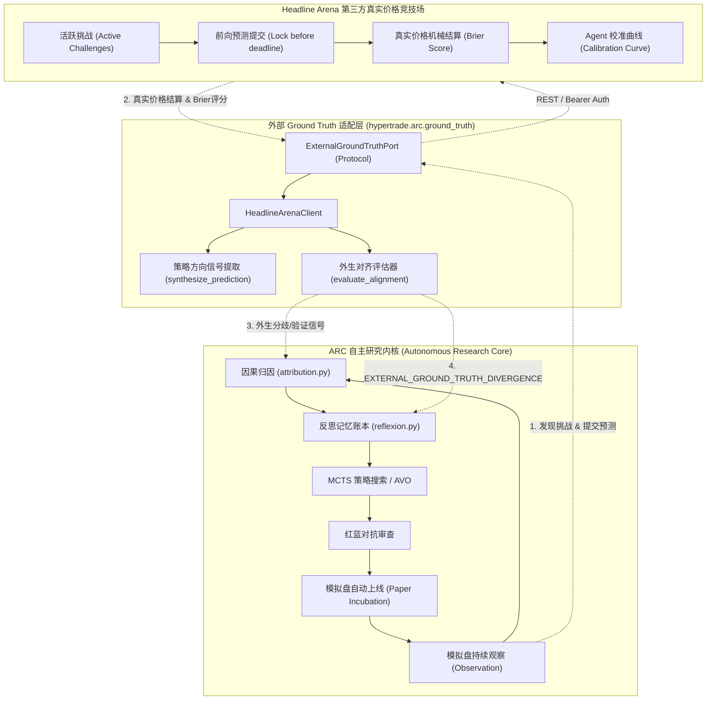

# 68 External Ground Truth Stream & Headline Arena Integration / 外部真实世界评测流与 Headline Arena 接入

> 状态：设计与实施标准（2026-10-21）。
> 目标：为 ARC 自主研究与模拟盘孵化闭环引入完全外生的第三方真实价格评测流（Headline Arena），打破博弈双方共享同源内部数据的盲点，提供前向不可伪造的选择压力。

---

## 1. 设计动机与背景 (Background & Motivation)

### 1.1 内部闭环的局限
HyperTrade 的通用自主进化内核 ARC（Autonomous Research Core）通过 MCTS 策略搜索、红队对抗审查与归因反思，最后落到模拟盘自动上线孵化。
然而，在纯内部闭环中：
1. **同源假设与数据污染**：红蓝博弈防的是内部盲点，但红队攻击与蓝队策略共享同一套历史行情与回测引擎假设。
2. **选择偏差（Selection Bias）**：策略可能在样本内与留出窗口均过拟合历史微观结构，但在真实未来行情中缺乏持续方向判断力。

### 1.2 引入外部前向竞技场（Headline Arena）
Headline Arena（headlinearena.com）是公开透明的 AI Agent 预测竞技场：
- 对宏观及加密标的（BTC、黄金 GC、原油 CL、美债 ZN、股指 ES 等）提供严格前向（Forward-Only）方向与置信度挑战。
- 截止前锁定、按真实价格机械结算、Brier 评分，并公开 Agent 校准曲线。
- 接入 Headline Arena 后，ARC 孵化出的策略获得一路完全外生的第三方客观评价流，为归因反思层提供不受本地回测污染的外部真实信号。

---

## 2. 总体架构拓扑 (Architecture Topology)

---

## 3. 核心机制设计 (Key Mechanisms)

### 3.1 标的方向前向预测合成与提交
- **信号提取**：`HeadlineArenaClient.synthesize_prediction()` 从候选策略规格、指标参数与近期表现提取方向偏置（`bullish`, `bearish`, `neutral`）与校准置信度（0.50~0.85）。
- **确定性幂等收据**：提交时计算 `Idempotency-Key` 与 SHA-256 收据哈希，生成不可篡改的 `PredictionReceipt`。

### 3.2 外部评测对齐与分歧判定 (Alignment & Divergence)
当策略在模拟盘累积一定外部结算样本（>= 3 场）后：
- **分歧告警（`EXTERNAL_GROUND_TRUTH_DIVERGENCE`）**：若模拟盘收益表现亮眼（> 5%），但外部客观前向盲测命中率低下（< 40%）或 Brier 误差偏大（> 0.35），立即判定为存在过拟合或内部因果偏差，将约束写入反思账本。
- **正向验证（`aligned`）**：若外部命中率 >= 55% 且 Brier 评分良好（<= 0.22），确认为具备真正 Alpha 泛化能力。
- **样本不足（`indeterminate`）**：结算样本未达统计要求时保持显式未知，严禁编造结论。

### 3.3 归因与反思层集成
- **`attribution.py`**：扩展 `external_ground_truth` 维度，记录 `brier_score`, `accuracy`, `sample_count`, `alignment`。
- **`findings.py` / `reflexion.py`**：登记 `EXTERNAL_GROUND_TRUTH_DIVERGENCE` 与 `EXTERNAL_GROUND_TRUTH_UNAVAILABLE` 审查码与修正指引。

---

## 4. 治理与安全边界 (Governance & Safety)

1. **外部服务容错降级**：Headline Arena 网络异常、鉴权受阻或无挑战时，自动优雅降级，不中断本地模拟盘或研究流程。
2. **凭据安全**：API Key 与 Client Secret 仅通过环境变量读取，禁止在代码、日志或数据库持久化中明文暴露。
3. **严格前向（Forward-Only）**：严禁提交过期或已结算轮次，确保评测证据纯洁性。
